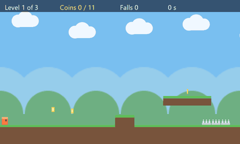
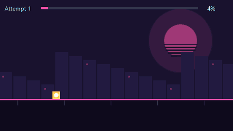
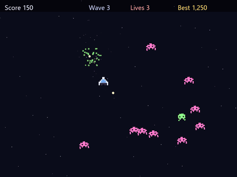
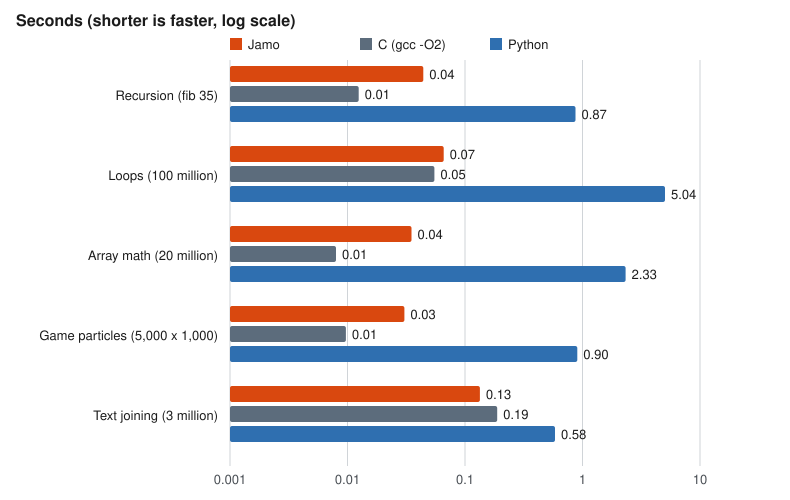

<p align="center"></p>

<h1 align="center">Jamo</h1>

<p align="center"><b>A small, friendly programming language that turns your code into real Windows programs.</b></p>

---

## What is Jamo?

Jamo is a programming language: a way to write instructions for a computer. You write a `.jamo` file in plain text, run one command, and Jamo turns it into a real `.exe` program that runs on any Windows PC, with nothing else to install.

- **Easy to read.** Words like `func`, `if`, `while` and `end`, with no curly brackets or semicolons to forget.
- **Catches mistakes before the program runs**, and explains them in plain English, pointing at the exact spot.
- **Makes real programs.** Jamo writes the machine code itself, so the programs are small and fast: about 20 to 75 times faster than the same code in Python.
- **Can make games.** Windows, 2D drawing, sound, buttons and sliders, 3D scenes and the internet are all built in.
- **Cleans up after itself.** You never have to free memory by hand.
- **Built from scratch.** No borrowed compiler or engine underneath. The Jamo compiler is even written in Jamo.

> Jamo is young, and it only runs on Windows for now. See [what it can't do yet](#what-jamo-cant-do-yet).

## A quick look

```jamo
struct Player
    name: string
    lives: int
end

func Player.hit()
    self.lives -= 1
end

func main()
    var sam = Player{name: "Sam", lives: 3}
    sam.hit()
    print(f"{sam.name} has {sam.lives} lives left")
    for i in 1..4
        print(f"Wave {i}!")
    end
end
```

```output
Sam has 2 lives left
Wave 1!
Wave 2!
Wave 3!
```

And when something's wrong, Jamo says what and where, before the program ever runs:

```
game.jamo line 8: This holds an int, but this value is a string.
        sam.lives = "lots"
                    ^^^^^^
```

## Install

1. Download the Jamo zip from the **Releases** page (on the right of this page). It's about 210 KB.
2. Unzip the whole folder anywhere, like your Desktop.
3. Double-click **`install.cmd`**. It puts Jamo where your terminal can find it, just for your Windows user, with no administrator needed.
4. Open a **new** terminal (search for "Terminal" or "PowerShell" in the Start menu) and type:

```
jamo version
```

If it answers with a version number, you're ready. `uninstall.cmd` takes it all away again.

## Your first program

1. Make a file called `hello.jamo` in any text editor (Notepad works) and type:

```jamo
func main()
    var name = "world"
    print(f"Hello, {name}!")
    print(2 + 3)
end
```

2. In the terminal, go to that folder and run it:

```
jamo run hello.jamo
```

```output
Hello, world!
5
```

`jamo build hello.jamo` makes `hello.exe` instead, a program you can double-click or send to a friend.

Next, the **[guide](GUIDE.md)** teaches the whole language from zero, one small step at a time, with something to try after each step. You don't need to know any other language.

## Make a game



*Sky Hopper, from [examples/platformer.jamo](examples/platformer.jamo): under 500 lines of Jamo, a 93 KB `.exe` that needs nothing else.*



*Beat Run, from [examples/beat_run.jamo](examples/beat_run.jamo): a one-button rhythm game whose music is made in code and mixed into one clip, so the game follows the song's own clock.*



*Star Guard, from [examples/star_guard.jamo](examples/star_guard.jamo): an arena shooter for keyboard and mouse or a controller. Each kind of drone's movement is a function made in place, the art is drawn from rows of text, and the explosions come from `particles.jamo`.*

This is a whole game. Move with the arrow keys and catch the coins:

```jamo check-only
use "gfx.jamo"
use "vec.jamo"
use "math.jamo"

var score = 0

func main()
    var window = open_window("Catch the coins", 640, 480)
    var screen = start_gfx(window)
    var player = vec2(320.0, 240.0)
    var coin = vec2(100.0, 100.0)
    while window.is_open()
        var move = vec2(0.0, 0.0)
        if window.key_down("left")
            move = move.plus(vec2(-1.0, 0.0))
        end
        if window.key_down("right")
            move = move.plus(vec2(1.0, 0.0))
        end
        if window.key_down("up")
            move = move.plus(vec2(0.0, -1.0))
        end
        if window.key_down("down")
            move = move.plus(vec2(0.0, 1.0))
        end
        player = player.plus(move.normalized().times(5.0))
        if player.distance(coin) < 30.0
            score += 1
            coin = vec2(float(random_int(20, 620)), float(random_int(20, 460)))
        end
        screen.clear(rgb(20, 24, 36))
        screen.circle(coin.x, coin.y, 12.0, rgb(255, 210, 60))
        screen.circle(player.x, player.y, 18.0, rgb(90, 170, 255))
        screen.text(f"Score: {score}", 16.0, 14.0, 22.0, rgb(240, 240, 240))
        screen.show()
        window.wait_frame(60)
    end
end
```

`jamo new --game mygame` makes a folder with a small game like this to start from, and `jamo build --window game.jamo` makes a game `.exe` with no console window behind it, ready to share.

## What's in the box

The [examples](examples) folder has fifteen programs to play with and change:

| In the console | In a window |
|---|---|
| Guessing game, calculator, to-do list | Sky Hopper (a platformer), Beat Run (a rhythm game), Breakout and Snake |
| Text adventure, word counter, prime finder | Bouncing balls |
| Lunar lander, web page fetcher | A sign-up form, a spinning 3D scene |

And these libraries come built in. Write `use "name.jamo"` at the top of a file to use one:

| Library | What it's for |
|---|---|
| `window`, `gfx` | Windows, the keyboard and mouse, and 2D drawing: shapes, text and images |
| `sprite` | Sprite sheets and animations, with pixel art made from text, mirroring and turning |
| `gamepad` | Xbox-style controllers for up to 4 players: buttons, sticks, triggers and rumble |
| `particles` | Sparks, explosions, smoke and trails that move, fall, slow down and fade |
| `sound` | Sounds and whole songs, made in code or loaded from files |
| `ui` | Buttons, sliders, checkboxes and text boxes |
| `g3d` | 3D scenes with lights, shapes and models |
| `vec`, `grid`, `timer` | Game helpers: 2D points and directions, boards and tile maps, cooldowns and repeating timers |
| `net` | Web requests, and links between programs for multiplayer |
| `math`, `time` | Square roots, angles, random numbers, the clock and waiting |
| `maybe` | A value that might not be there (`Maybe`), and pairs and triples for giving back more than one thing |
| `map`, `dict`, `list` | Looking things up by key, and arrays: finding, counting, sorting, reversing, shuffling and picking items of any type |
| `text`, `builder`, `json`, `bytes` | Working with text, JSON files and binary data |
| `files`, `term`, `log`, `test` | Folders and files (with `read_file_or` that never stops the program), colors in the console, log files, and checking your own code |
| `png` | Saving images |

## The language at a glance

| | |
|---|---|
| Values | `int`, `float`, `bool`, `string`, arrays like `[int]` |
| Your own types | `struct` with methods, `enum` |
| Choices and loops | `if` / `elif` / `else`, `match`, `while`, `for i in 0..10`, `for item in items` |
| Generics | `func first<T>(items: [T]): T` and `struct Pair<A, B>`, for code that works with any type |
| Sharing | Variables outside functions, constants, and splitting a program into files with `use` |
| Text | `f"Score: {score}"` puts values straight into text |

The exact rules are in [LANGUAGE.md](LANGUAGE.md).

## How fast is it?

Jamo writes real machine code, the same kind a C compiler makes. The same five programs in Jamo, C and Python, timed on one PC (a Ryzen 5 7600), best of 5:



| Test | Jamo | C (gcc -O2) | Python | Jamo vs Python |
|---|---|---|---|---|
| Recursion (Fibonacci 35) | 0.044 s | 0.012 s | 0.87 s | 20x faster |
| A loop 100 million times | 0.066 s | 0.055 s | 5.04 s | 76x faster |
| Array math | 0.035 s | 0.008 s | 2.33 s | 66x faster |
| A game-like test (5,000 particles) | 0.031 s | 0.010 s | 0.90 s | 29x faster |
| Joining text 3 million times | 0.134 s | 0.188 s | 0.58 s | 4x faster |

C is still faster at number crunching, about 1.2 to 4 times, since its compiler does many more tricks. Jamo wins at joining text because it hands out small blocks of memory itself. Run `python bench/run_bench.py` to time it on your PC: it checks that all three languages print the same answers, and redraws the chart.

## How it works

```
  your code          jamo                        a real program
 game.jamo  ──►  reads it, checks it,   ──►   game.exe
                 writes x86-64 machine
                 code and the .exe file
```

Most new languages lean on a big existing compiler to make the final program. Jamo does every step itself: it reads your code, checks the types, writes the machine code byte by byte, and builds the `.exe` file Windows runs. A tiny built-in runtime handles printing, text, files and cleaning up memory.

The compiler is written in Jamo too. A second copy written in C++ lives in [src](src), so Jamo can always be rebuilt from nothing, and the two must make exactly the same `.exe` files, byte for byte.

## Commands

| Command | What it does |
|---|---|
| `jamo run file.jamo` | Builds the program and runs it. Anything after the file goes to the program |
| `jamo watch file.jamo` | Runs it, then builds and runs it again every time you save. A mistake shows straight away, and the last version that worked keeps running |
| `jamo build file.jamo` | Writes `file.exe` beside the code |
| `jamo build --window file.jamo` | Writes a window program with no console, for sharing games |
| `jamo check file.jamo` | Finds mistakes without making an `.exe` |
| `jamo new name` | Makes a folder with a program to start from (`--game` for a small game) |
| `jamo run --trace file.jamo` | Runs it, showing each of your own functions as it starts, indented by how deep the calls go |
| `jamo fmt file.jamo` | Tidies the indentation and spacing, without changing what the program does |
| `jamo get someone/project` | Downloads a library someone shared on GitHub into `packages`, and says the `use` line for it |
| `jamo version`, `jamo help` | What they say |

## Playground

`playground/jamo_playground.pyw` is a small editor for trying Jamo without setting anything up: type code, press **Run** (or Ctrl+Enter) and see what it prints. It colors the code, marks the line of a mistake (click the error to jump there), lets you type answers when a program asks for input, opens every example from one menu, and stops a program that runs forever. It needs Python 3 and finds `jamo.exe` beside it or on the PATH.

## VS Code

The extension colors Jamo code and underlines mistakes in red as you type. Hover over a name to see what it is and the comment above it, Ctrl+click (or F12) to jump to where it's made, even inside the built-in libraries, see every function and struct in the Outline panel, and get suggestions as you type, including fields and methods after a dot. Download `jamo.vsix` from the **Releases** page, then in VS Code open the Extensions panel, click the `...` menu at its top, and choose **Install from VSIX**. Its source is in the [vscode](vscode) folder, and `python vscode/make_vsix.py` builds it.

## What Jamo can't do yet

- It only runs on Windows.

The end of the [guide](GUIDE.md#what-jamo-cant-do-yet) has the full list.

## Questions

**Do I need to know how to code?** No. The [guide](GUIDE.md) starts from zero.

**Do people who run my program need Jamo?** No. A built `.exe` runs on its own on any 64-bit Windows PC.

**Why does Windows warn about my `.exe`?** Windows shows a warning for new programs it hasn't seen before, from anyone. Click "More info", then "Run anyway". It's the same for every new program that isn't signed, which costs money.

**Is it safe?** Jamo checks types, array sizes and dividing by zero, and cleans up memory by itself, so the usual crashes of low-level languages can't happen in normal code. The `peek`, `poke` and `extern` tools for talking to Windows directly are the exception, and say so.

## Building Jamo itself

You need g++ with C++20 (like [WinLibs](https://winlibs.com)) and, for the tests, Python.

```
build.bat
python tests/run_tests.py
```

`build.bat` builds the C++ compiler, uses it to build the Jamo-written compiler, then has that one build itself again and checks the two match byte for byte. The test suite runs hundreds of programs, checks every error message, and compares thousands of random programs with Python's answers.

## More

- [GUIDE.md](GUIDE.md): learn Jamo from zero
- [LANGUAGE.md](LANGUAGE.md): the exact rules of the language
- [CHANGELOG.md](CHANGELOG.md): what changed
- [DECISIONS.md](DECISIONS.md): why things are the way they are
- [runtime](runtime): the runtime's source. `python runtime/make_runtime.py` checks every instruction with GNU as and rewrites `src/runtime.cpp` and `compiler/runtime.jamo`
- [LICENSE](LICENSE): MIT
